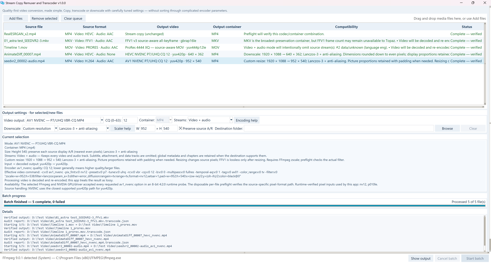
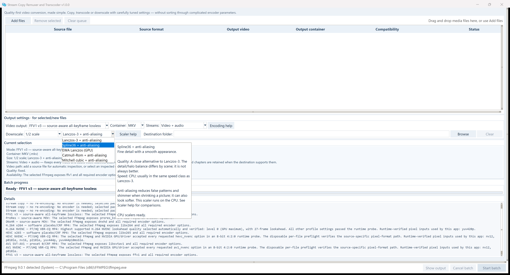

# Stream Copy Remuxer and Transcoder

**High-quality video conversion, made simple.**

Copy, convert and resize videos with the optimal, best quality presets already built in. The app handles the complicated settings for you. If you want to adjust quality or file size, change just one quality value and follow the built-in tips.

## Download v1.0.0

[**Download for Windows**](https://github.com/skv89/Stream-Copy-Remuxer-and-Transcoder/raw/refs/tags/v1.0.0/Stream%20Copy%20Remuxer%20and%20Transcoder.exe) · [ZIP download](https://github.com/skv89/Stream-Copy-Remuxer-and-Transcoder/releases/download/v1.0.0/Stream-Copy-Remuxer-and-Transcoder-Windows-x64.zip)

Open the app to begin. If you download the ZIP, extract it first.



## Get started

1. **Add your videos** by dragging them into the app.
2. **Choose an output** and keep the defaults, or adjust the quality and size.
3. **Click Start batch.** When finished, right-click a completed file to open its output folder.

Hover over choices in a dropdown to see helpful tips before selecting. The app automatically inspects your videos and checks compatibility.



## What you can do

- **Stream copy:** change the video container, such as MKV to MP4, without re-encoding or reducing quality.
- **Convert:** choose H.264, HEVC or AV1 for compressed video, FFV1 for lossless output, or ProRes/DNxHR for editing.
- **Resize:** choose half, third, quarter or custom size. Preserve source A/R keeps the picture's proportions automatically.
- **Batch process:** give different files different settings. Original files are never overwritten.

By default, the app keeps video and audio. Use **Streams** if you also need subtitles or other tracks.

Quality-first settings can take longer and produce larger files. Resizing changes the picture, including when using FFV1.

## Requirements

- **Windows 10 or 11, 64-bit.**
- **FFmpeg:** the app can help install it if needed; installation requires internet access.
- **Optional GPU features:** NVIDIA encoding needs a compatible NVIDIA graphics card. EWA resizing needs a working Vulkan graphics driver. CPU options are also available.

The app is not digitally signed, so Windows may show a security warning.

<details>
<summary>Download verification</summary>

Version: **1.0.0**  
File size: **19,692,082 bytes**  
SHA-256:

```text
3F56DBF1B8A76F86BF750F657410F0BC918BCDE7B89A4FC5B360A422A39D70D1
```

</details>

[Release notes](https://github.com/skv89/Stream-Copy-Remuxer-and-Transcoder/releases/tag/v1.0.0) · [Third-party notices](THIRD_PARTY_NOTICES.md)
