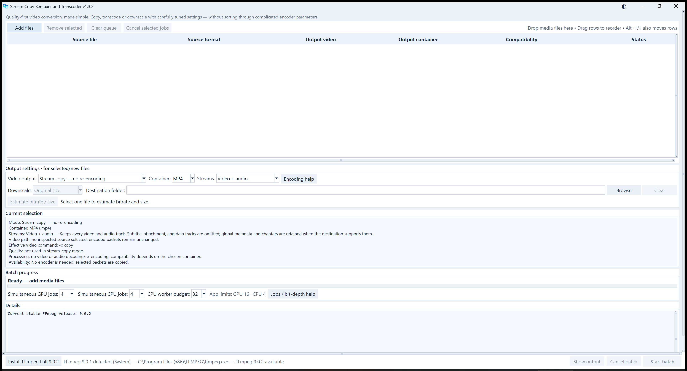
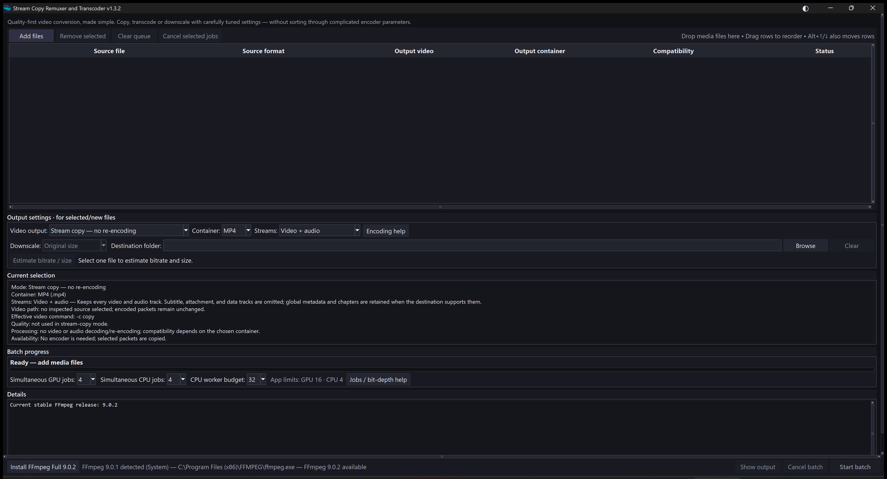

# Stream Copy Remuxer and Transcoder

**High-quality video conversion, made simple.**

Copy, convert and resize videos with the optimal, best quality presets already built in. The app handles the complicated settings for you. If you want to adjust quality or file size, change just one quality value and follow the built-in tips.

## Download v1.3.2

[**Download for Windows — portable ZIP**](https://github.com/skv89/Stream-Copy-Remuxer-and-Transcoder/releases/download/v1.3.2/Stream-Copy-Remuxer-and-Transcoder-v1.3.2-Windows-x64.zip)

Extract the ZIP into a writable folder, then open **Stream Copy Remuxer and Transcoder.exe**. Python is included; no separate Python installation is needed.



## What's new in v1.3.2

- **Remembered light or dark mode.** Use the button beside Minimize, or press Ctrl+Shift+D.
- **More room for files.** The queue has one additional row and the Details log is more compact.
- **Settings grouped together.** Software effort sits beside the other output choices when applicable.
- **A compact footer.** The FFmpeg button and status share one line; hover to see the full status.
- **Portable preferences.** Settings, logs, cache and temporary runtime files stay in the app folder.



## Get started

1. The app checks its FFmpeg subfolders, then FFmpeg/FFprobe copied beside the EXE, then your system PATH. It requires **FFmpeg 9 or newer and a matching FFprobe**. If none qualifies, accept the download offer; tools go into `ffmpeg\<version>\bin`. Downloads need internet access.
2. **Add your videos** by dragging them into the app.
3. **Choose an output**, quality and optional size. Hover over choices for guidance.
4. **Click Start batch.** Right-click a completed file to open its output folder.

## What you can do

- **Stream copy:** change containers without re-encoding selected streams.
- **Convert:** use H.264, HEVC, AV1, FFV1, ProRes or DNxHR.
- **Resize:** choose a scale or custom dimensions while preserving picture proportions.
- **Batch process:** use per-file settings, separate CPU/GPU job limits and a shared CPU worker budget.

The default keeps video and audio. Use **Streams** for subtitles or other tracks. Source files and existing outputs are preserved. Quality-first settings can take longer and produce larger files; sample size estimates are approximate. Resizing changes the picture, including with FFV1.

## Move or update

Close the app and replace only the EXE to update. Keep **data** for saved preferences and **ffmpeg** for downloaded tools. Copy those folders with the EXE when moving to another computer. Existing system FFmpeg installations are not modified.

The EXE contains the app runtime. FFmpeg is detected or downloaded separately. Temporary runtime files use **data/temp** and are removed on normal exit; force-closing can leave local temporary files. Allow at least 100 MB of runtime space, plus space for downloaded tools and video outputs.

## Requirements

- **64-bit Windows 10 or 11** and a writable app folder.
- **FFmpeg 9+ and matching FFprobe**, detected automatically or downloaded through the app.
- GPU encoding requires compatible NVIDIA hardware and drivers. EWA resizing requires a working Vulkan driver. CPU options are available; 10-bit output requires a compatible player.

The app is not digitally signed, so Windows may show a security warning.

<details>
<summary>Download verification</summary>

Version: **1.3.2**  
EXE size: **19,934,381 bytes**  
SHA-256:

```text
2876399AF85478C52374ED9A6081678605994C22B0516D223B81DEAA4906D2D7
```

</details>

[Release notes](https://github.com/skv89/Stream-Copy-Remuxer-and-Transcoder/releases/tag/v1.3.2) · [Third-party notices](THIRD_PARTY_NOTICES.md)
