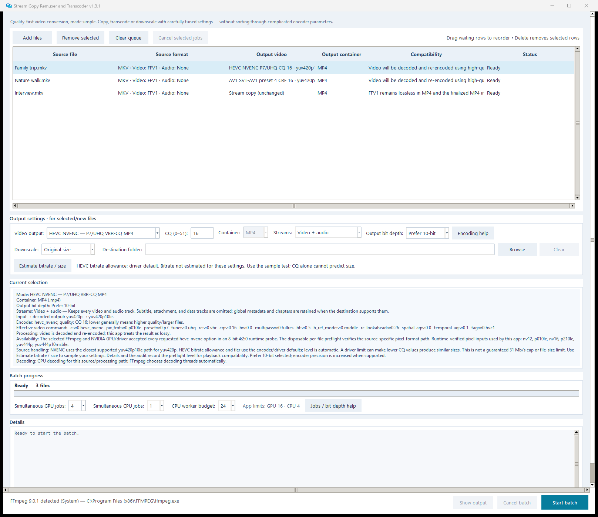
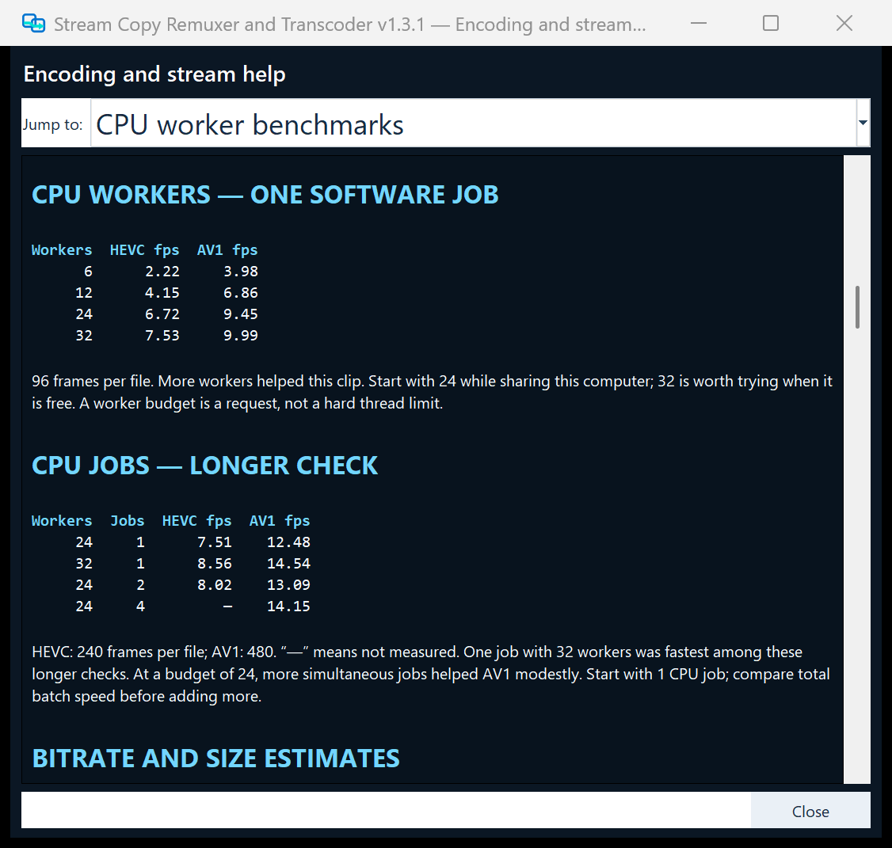

# Stream Copy Remuxer and Transcoder

**High-quality video conversion, made simple.**

Copy, convert and resize videos with the optimal, best quality presets already built in. The app handles the complicated settings for you. If you want to adjust quality or file size, change just one quality value and follow the built-in tips.

## Download v1.3.1

[**Download for Windows**](https://github.com/skv89/Stream-Copy-Remuxer-and-Transcoder/raw/refs/tags/v1.3.1/Stream%20Copy%20Remuxer%20and%20Transcoder.exe) · [ZIP download](https://github.com/skv89/Stream-Copy-Remuxer-and-Transcoder/releases/download/v1.3.1/Stream-Copy-Remuxer-and-Transcoder-v1.3.1-Windows-x64.zip)

Open the app to begin. If you download the ZIP, extract it first.



## Get started

1. **Add your videos** by dragging them into the app.
2. **Choose an output** and keep the defaults, or adjust the quality and size.
3. **Click Start batch.** When finished, right-click a completed file to open its output folder.

Hover over choices in a dropdown to see helpful tips before selecting. The app automatically inspects your videos and checks compatibility.


## What you can do

- **Stream copy:** change the video container, such as MKV to MP4, without re-encoding or reducing quality.
- **Convert:** choose H.264, HEVC or AV1 for compressed video, FFV1 for lossless output, or ProRes/DNxHR for editing.
- **Resize:** choose half, third, quarter or custom size. Preserve source A/R keeps the picture's proportions automatically.
- **Batch process:** give different files different settings. Original files are never overwritten.

By default, the app keeps video and audio. Use **Streams** if you also need subtitles or other tracks.

Quality-first settings can take longer and produce larger files. Resizing changes the picture, including when using FFV1.

## What's new in v1.3.1

- **Run CPU and GPU jobs together.** Separate job limits let you choose how many files each processes at once. Available limits depend on your hardware.
- **Choose software encoding effort.** Faster, Balanced, Quality and Extreme let you trade encoding time for compression. Quality is the default; Extreme can be very slow.
- **Share a CPU worker budget.** Choose how many encoder workers software jobs share. Running jobs keep their allocation; this is not a hard limit on total CPU use.
- **Choose your bit depth.** HEVC and AV1 offer **Match source** or **Prefer 10-bit**. The latter uses 10-bit output when supported; your player must support it.
- **Edit a running queue.** Reorder or remove waiting files. Removing an active job asks for confirmation, stops that job and removes its unfinished output. Source files and completed outputs are preserved.
- **Get a sense of output size.** Sample-based bitrate and size estimates help before encoding; progress shows measured bitrate and a projected size while encoding.
- **Use GPU decoding when supported.** Compatible NVIDIA inputs use GPU decoding automatically, with CPU fallback when needed.
- **Find help faster.** Larger headings, a Jump to menu, shorter explanations and benchmark tables help you choose settings.



Benchmark examples are guidance; speed depends on your video and hardware. More simultaneous jobs are not always faster.

## Requirements

- **Windows 10 or 11, 64-bit.**
- **FFmpeg:** the app can help install it if needed; installation requires internet access.
- **Optional GPU features:** NVIDIA encoding needs a compatible NVIDIA graphics card. EWA resizing needs a working Vulkan graphics driver. CPU options are also available.

The app is not digitally signed, so Windows may show a security warning.

<details>
<summary>Download verification</summary>

Version: **1.3.1**  
File size: **19,863,750 bytes**  
SHA-256:

```text
29F701D7ADC8853A99B8CE1016682FC36AD0BEBDBFB6A14FADAB37289836757F
```

</details>

[Release notes](https://github.com/skv89/Stream-Copy-Remuxer-and-Transcoder/releases/tag/v1.3.1) · [Third-party notices](THIRD_PARTY_NOTICES.md)
